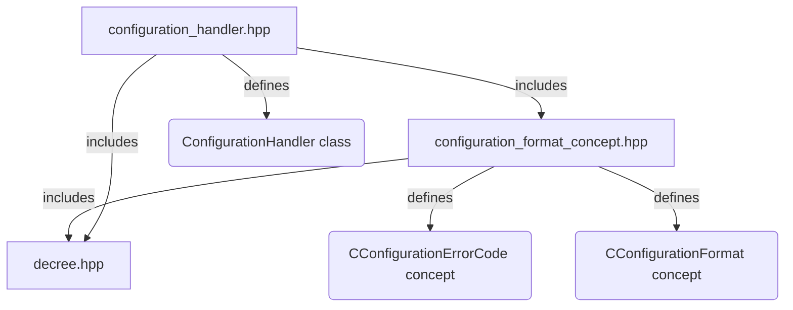
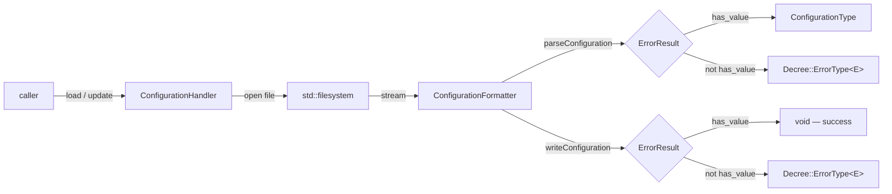
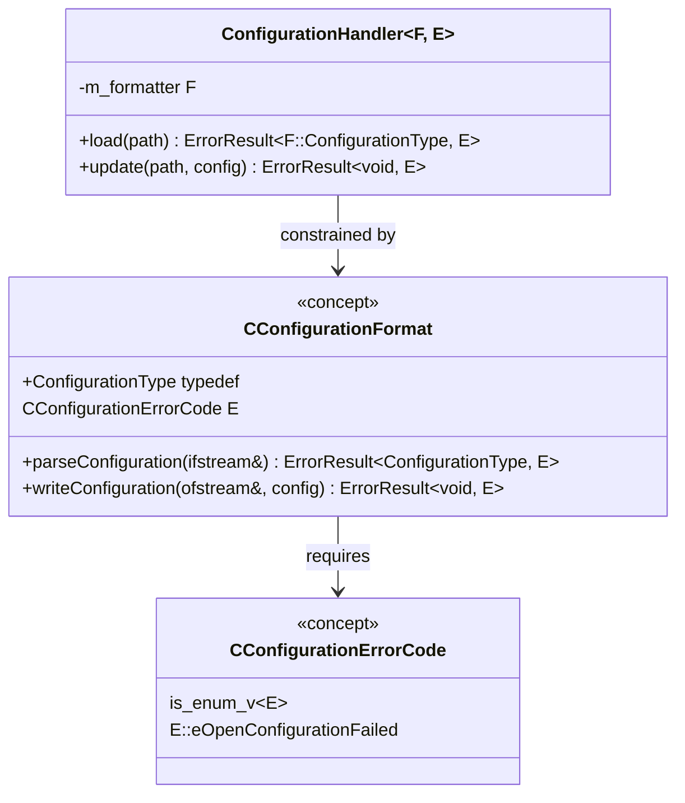

# Configuration Handler Library

A lightweight C++23 library for loading and updating configuration files. It provides a generic `ConfigurationHandler` class and a `CConfigurationFormat` concept that constrains formatter types to a uniform read/write interface.

---

## Table of Contents

1. [Overview](#overview)
2. [Architecture](#architecture)
3. [Headers](#headers)
4. [CConfigurationFormat concept](#cconfigurationformat-concept)
5. [ConfigurationHandler](#configurationhandler)
6. [Writing a custom formatter](#writing-a-custom-formatter)
7. [Real-world example](#real-world-example)
8. [How to build](#how-to-build)
9. [Running the tests](#running-the-tests)

---

## Overview

The library solves two problems:

- **Format independence** — the handler is decoupled from any specific file format (JSON, TOML, INI, …). Formatters are swapped by changing a template argument, not by subclassing.
- **Explicit failure paths** — `load` and `update` return `Decree::ErrorResult` (an alias for `std::expected`) instead of throwing. Callers are forced by the type system to handle both outcomes.

The building blocks are independent and composable:

| Building block | Role |
|---|---|
| `CConfigurationErrorCode<E>` | Compile-time constraint for the error-code enum |
| `CConfigurationFormat<F, E>` | Compile-time constraint for formatter types |
| `ConfigurationHandler<F, E>` | File I/O orchestrator — delegates parsing/writing to the formatter |

> **Note on the second template parameter.** `E` is the **error-code enum itself** (e.g.
> `EAppError`), not a wrapper type. `Decree::ErrorType<E>` is built from it internally.

---

## Architecture

### Header dependency graph



### Load / update flow



### Type relationships



---

## Headers

| Header | Provides |
|---|---|
| `src/configuration_format_concept.hpp` | `CConfigurationErrorCode` concept, `CConfigurationFormat` concept |
| `src/configuration_handler.hpp` | `ConfigurationHandler` class template |

The library is an `INTERFACE` (header-only) CMake target — nothing is compiled into an archive.

---

## `CConfigurationFormat` concept

**Header:** `configuration_format_concept.hpp`

Constrains a formatter type so it is interchangeable inside `ConfigurationHandler`. Useful for writing generic utilities or test doubles that must satisfy the same interface.

```cpp
template<typename EErrorCodes>
concept CConfigurationErrorCode = std::is_enum_v<EErrorCodes> && requires {
    { EErrorCodes::eOpenConfigurationFailed };
};

template<typename Parser, typename EErrorCodes>
concept CConfigurationFormat =
    CConfigurationErrorCode<EErrorCodes> &&
    requires(Parser parser,
             std::ifstream& stream,
             std::ofstream& writeStream,
             const typename Parser::ConfigurationType& configuration) {
        typename Parser::ConfigurationType;
        { parser.parseConfiguration(stream)                     } -> std::same_as<Decree::ErrorResult<typename Parser::ConfigurationType, EErrorCodes>>;
        { parser.writeConfiguration(writeStream, configuration) } -> std::same_as<Decree::ErrorResult<void, EErrorCodes>>;
    };
```

### Requirements

| Requirement | Description |
|---|---|
| `Parser::ConfigurationType` | The deserialized configuration type produced by `parseConfiguration`. |
| `parser.parseConfiguration(ifstream&)` | Reads from the stream and returns `Decree::ErrorResult<ConfigurationType, EErrorCodes>`. |
| `parser.writeConfiguration(ofstream&, config)` | Serializes `config` to the stream and returns `Decree::ErrorResult<void, EErrorCodes>`. |
| `CConfigurationErrorCode<EErrorCodes>` | `EErrorCodes` must be an enum type and must declare the enumerator `eOpenConfigurationFailed` — `ConfigurationHandler` uses it for file-open failures. |

---

## ConfigurationHandler

**Header:** `configuration_handler.hpp`

A generic class that owns a formatter instance and handles all file-system concerns — opening files, creating directories — before delegating to the formatter.

```cpp
template<typename ConfigurationFormatter, typename EErrorCodes>
requires CConfigurationFormat<ConfigurationFormatter, EErrorCodes>
class ConfigurationHandler {
public:
    template<typename T>
    using ReturnType = Decree::ErrorResult<T, EErrorCodes>;
    // ...
};
```

### Template parameters

| Parameter | Constraint | Description |
|---|---|---|
| `ConfigurationFormatter` | `CConfigurationFormat<ConfigurationFormatter, EErrorCodes>` | The formatter that parses and writes the configuration. |
| `EErrorCodes` | `CConfigurationErrorCode<EErrorCodes>` (via `CConfigurationFormat`) | The error-code **enum** returned on failure. Must declare `eOpenConfigurationFailed`. |

### Member functions

#### `load`

```cpp
[[nodiscard]] ReturnType<typename ConfigurationFormatter::ConfigurationType>
    load(const std::filesystem::path& configurationPath);
```

Opens `configurationPath` for reading and delegates to `ConfigurationFormatter::parseConfiguration`. Returns an error with `EErrorCodes::eOpenConfigurationFailed` if the file cannot be opened.

#### `update`

```cpp
[[nodiscard]] ReturnType<void>
    update(const std::filesystem::path& configurationPath,
           const typename ConfigurationFormatter::ConfigurationType& configuration);
```

Creates any missing parent directories (only when `configurationPath` has a parent), opens `configurationPath` for writing, and delegates to `ConfigurationFormatter::writeConfiguration`. Returns an error with `EErrorCodes::eOpenConfigurationFailed` if the file cannot be opened.

---

## Writing a custom formatter

Any type satisfying the `CConfigurationFormat` requirements can be passed to `ConfigurationHandler`. The error-code enum must additionally declare `eOpenConfigurationFailed` because `ConfigurationHandler` uses it for file-open failures.

```cpp
#include "configuration_handler.hpp"
#include "configuration_format_concept.hpp"
#include "decree.hpp"

enum class EAppError {
    eOpenConfigurationFailed,   // required by CConfigurationErrorCode
    eParseError
};

struct IniFormatter {
    struct ConfigurationType {
        std::string host;
        int         port = 0;
    };

    Decree::ErrorResult<ConfigurationType, EAppError> parseConfiguration(std::ifstream& stream) {
        ConfigurationType config;
        std::string line;

        while(std::getline(stream, line)) {
            if(line.starts_with("host="))
                config.host = line.substr(5);
            else if(line.starts_with("port="))
                config.port = std::stoi(line.substr(5));
        }

        if(config.host.empty())
            return Decree::makeError(EAppError::eParseError, "missing 'host' key");

        return config;
    }

    Decree::ErrorResult<void, EAppError> writeConfiguration(std::ofstream& stream, const ConfigurationType& config) {
        stream << "host=" << config.host << "\n"
               << "port=" << config.port << "\n";

        return {};
    }
};

static_assert(CConfigurationFormat<IniFormatter, EAppError>);
```

Using the formatter with `ConfigurationHandler`:

```cpp
ConfigurationHandler<IniFormatter, EAppError> handler;

// load
auto result = handler.load("app.ini");
if(!result) {
    log(result.error().getErrorMessage());
    return;
}
use(result->host, result->port);

// update
const auto writeResult = handler.update("app.ini", IniFormatter::ConfigurationType{ "localhost", 8080 });
if(!writeResult)
    log(writeResult.error().getErrorMessage());
```

---

## Real-world example

The in-repository consumer is `TestIoBoardConfigurationFormat` (see
[`test_io_board/src/test_io_board_configuration_format.hpp`](../../test_io_board/src/test_io_board_configuration_format.hpp)).
It wraps [nlohmann/json](https://github.com/nlohmann/json) and handles both deserialization and
serialization through the standard `CConfigurationFormat` interface.

### The formatter

```cpp
class TestIoBoardConfigurationFormat {
public:
    enum class EErrorCodes {
        eOpenConfigurationFailed,   // required by CConfigurationErrorCode
        eConfigurationFailed,
        eParseFailed,
        eWriteFailed
    };

    using ErrorType = Decree::ErrorType<EErrorCodes>;

    struct SerialCommunication {
        std::string comPortName;
        uint32_t    baudrate;
    };

    struct ConfigurationType {
        SerialCommunication serialCommunication;
        HardwareComponents  hardwareComponents;
    };

    [[nodiscard]] Decree::ErrorResult<ConfigurationType, EErrorCodes> parseConfiguration(std::ifstream& streamHandle);
    [[nodiscard]] Decree::ErrorResult<void, EErrorCodes>              writeConfiguration(std::ofstream& out, const ConfigurationType& configuration);
};
```

### parseConfiguration — reading from stream

Parse exceptions are caught and converted to the error type, so no exception escapes through the
`ErrorResult` boundary.

```cpp
auto TestIoBoardConfigurationFormat::parseConfiguration(std::ifstream& streamHandle)
    -> Decree::ErrorResult<ConfigurationType, EErrorCodes>
{
    nlohmann::json jsonFile;

    try {
        streamHandle >> jsonFile;

        return jsonFile.get<TestIoBoardConfigurationFormat::ConfigurationType>();
    } catch (const std::exception& exception) {
        return std::unexpected(ErrorType::makeError(EErrorCodes::eParseFailed,
            "Exception occurred during configuration parsing: " + std::string{ exception.what() }));
    }
}
```

### writeConfiguration — writing to stream

```cpp
auto TestIoBoardConfigurationFormat::writeConfiguration(std::ofstream& out, const ConfigurationType& configuration)
    -> Decree::ErrorResult<void, EErrorCodes>
{
    nlohmann::json j;

    try {
        j = configuration;

        static constexpr auto prettyPrintStepWidth = 4;
        out << std::setw(prettyPrintStepWidth) << j;

        return {};
    } catch (const std::exception& exception) {
        return std::unexpected(ErrorType::makeError(EErrorCodes::eWriteFailed,
            "Exception occurred during writing configuration: " + std::string{ exception.what() }));
    }
}
```

> Both `Decree::makeError(code, message)` and `std::unexpected(ErrorType::makeError(code, message))`
> produce the same value — the former is the shorter spelling.

### Calling code

```cpp
using BoardConfigurationHandler =
    ConfigurationHandler<TestIoBoardConfigurationFormat, TestIoBoardConfigurationFormat::EErrorCodes>;

BoardConfigurationHandler handler;

// Load the board configuration
const auto config = handler.load("configurations/vita_test_io_board_1.json");
if(!config) {
    std::println("Failed to load: {}", config.error().getErrorMessage());
    return;
}

// Modify and persist
auto updated = *config;
updated.serialCommunication.baudrate = 115200;

if(const auto result = handler.update("configurations/vita_test_io_board_1.json", updated); !result)
    std::println("Failed to save: {}", result.error().getErrorMessage());
```

### Monadic chaining

`Decree::ErrorResult` is a `std::expected`, so `and_then` / `or_else` work for fluent pipelines:

```cpp
using EErrorCodes = TestIoBoardConfigurationFormat::EErrorCodes;

handler.load("configurations/vita_test_io_board_1.json")
    .and_then([&handler](TestIoBoardConfigurationFormat::ConfigurationType configuration) {
        configuration.serialCommunication.baudrate = 115200;

        return handler.update("configurations/vita_test_io_board_1.json", configuration);
    })
    .or_else([](const Decree::ErrorType<EErrorCodes>& error) -> Decree::ErrorResult<void, EErrorCodes> {
        std::println("Error: {}", error.getErrorMessage());

        return std::unexpected(error);
    });
```

---

## How to build

### Prerequisites

| Tool | Minimum version | Notes |
| --- | --- | --- |
| CMake | 3.28 | Required for C++23 support |
| GCC | 14 | C++23 compiler |
| Ninja | any | Build system used in the commands below |

### Configure and build

```sh
cmake -S . -B build -G Ninja
cmake --build build
```

### Build with tests

Pass `-DCONFIGURATION_HANDLER_BUILD_TESTS=ON` at configure time:

```sh
cmake -S . -B build -G Ninja -DCONFIGURATION_HANDLER_BUILD_TESTS=ON
cmake --build build
```

> GTest is fetched automatically via `FetchContent` on the first configure with tests enabled. The `compile_commands.json` will include the GTest include path after this step, resolving IntelliSense errors in the test file.

### Output

The library is header-only and exposed as the `INTERFACE` target `json::configuration_handler`
(it links `decree::decree` transitively). Consume it in another CMake project with:

```cmake
target_link_libraries(my_target PRIVATE json::configuration_handler)
```

---

## Running the tests

Tests are written with [GoogleTest](https://github.com/google/googletest) v1.14.0 (fetched automatically by CMake via `FetchContent`).

### Run via CTest manually

```sh
ctest --test-dir build --output-on-failure
```

### Run the test executable directly

```sh
./build/tests/json_configuration_handler_test
```

### Test coverage areas

| Test suite | What it verifies |
| --- | --- |
| `LoadTest` | Success path, missing file error, error message content, formatter parse error propagation, empty file |
| `UpdateTest` | File creation with content, overwrite of existing file, parent directory creation, formatter write error propagation |
| `RoundTripTest` | Load after update returns original content, multiple updates retain last value |
| `CConfigurationFormatConceptTest` | Conforming formatter satisfies concept; a type without `ConfigurationType` and a non-enum error code are rejected |
| `JsonFileTest` | Loading individual fields from a JSON fixture and round-tripping all of them |

## GitHub Actions

Pull requests targeting `develop` or `development` build the project and run the tests.
To publish a release, push a tag matching `Configuration*_Handler_V<major>.<minor>.<patch>`
to a commit on `main` (for example, `Configuration_Handler_V0.0.1`). The release workflow
uses the version from the tag and attaches a ZIP source package to a GitHub Release.
